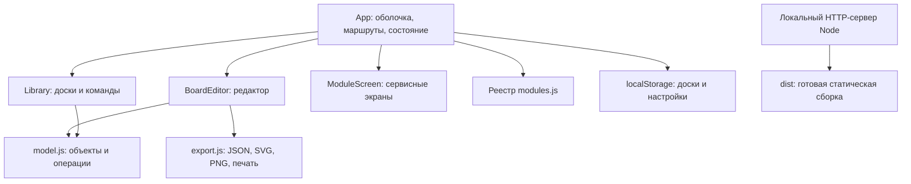

# Архитектура и источники

## Что удалось изучить об оригинале

Проверка выполнена 17 ноября 2026 года. В рабочей папке не было исходников. Открытая вкладка `app.workspace.vk.ru/board` обнаружена, но инструмент просмотра отклонил доступ по политике безопасности. Содержимое аккаунта, DOM, клиентские бандлы и внутренние запросы не исследовались. Обход блокировки не применялся.

Затем пользователь предоставил снимок экрана «Проекты» по адресу `app.workspace.vk.ru/projects`. По этому изображению воспроизведены тёмная оболочка и главный экран сервиса. Исходный снимок сохранён локально в `references/workspace-projects-source.png`. Пиктограммы нарисованы в SVG по видимым контурам, оригинальные файлы иконок не извлекались. Вёрстка остаётся редактируемой; скриншот не используется фоном интерфейса. Область сравнения исключает панели Chrome и Windows и составляет 1704 × 899 пикселей.

Использованы публичные первичные материалы:

- [Страница Доски VK WorkSpace](https://www.workspacevk.com/board/) — назначение, типы объектов, шаблоны, команды, взаимодействие сервисов. Содержимое получено через поисковый индекс; прямая загрузка страницы во время работы завершалась ошибкой соединения.
- [Как работать в VK Доске](https://help.mail.ru/vkboard/use/) — библиотека, инструменты нижней панели, доступ, фон, импорт файлов и экспорт. Это справка публичной версии Доски: она помогает восстановить общий редактор, но не доказывает совпадение с корпоративным аккаунтом.
- [Инструкция по установке Доски](https://biz.mail.ru/docs/on-premises/doska/install/doska-install-guide.pdf) — индексированный официальный PDF, 7 страниц, редакция от 27 апреля 2026 года. В таблице развёртывания перечислены `maxwell`, `maxwell-awareness`, `boardapi`, `boardapi-internal`, `boardapi-internal-http`, `aclapi`, `aclapi-internal`. Документ описывает контейнерную установку и масштабирование, а не исходники или внутреннюю реализацию этих сервисов. Переносить такую инфраструктуру для одиночного демонстрационного макета не требуется.
- [Обновления супераппа VK WorkSpace](https://www.workspacevk.com/blog/obnovleniya-superappa-vk-workspace/) — публичное описание общей оболочки и переходов между сервисами, использовано через поисковый индекс.

Часть старых ссылок документации перенаправляет в новый портал; пользовательский PDF напрямую получить не удалось. Полная актуальная архитектура оригинального продукта, язык его реализации и точная структура API по этим материалам не установлены. Здесь создан самостоятельный прототип поведения и визуальной структуры, а не копия оригинальных закрытых исходников.

## Устройство локального проекта

Браузер выполняет всю прикладную логику. Сервер только выдаёт готовые файлы и не принимает пользовательские данные. React используется для экранов и состояния, Vite — для разработки и сборки. Холст состоит из DOM-объектов и SVG для линий; общий transform реализует масштаб и перемещение.

### Основные файлы

| Файл | Ответственность |
| --- | --- |
| `src/App.jsx` | Оболочка, маршруты hash, данные пространства, настройки и диалоги |
| `src/components/WorkspaceChrome.jsx` | Логотип, пиктограммы, левая панель и верхние вкладки по эталону |
| `src/components/ProjectsDashboard.jsx` | Главная страница «Проектов», карточки и список пространств |
| `src/components/Library.jsx` | Библиотека, фильтры, команды, меню карточек |
| `src/components/BoardEditor.jsx` | Инструменты, жесты, текст, свойства, история, презентация |
| `src/components/ModuleScreen.jsx` | Экраны второстепенных сервисов и переходы на доски |
| `src/components/UI.jsx` | Общие элементы и реестр импортированных иконок |
| `src/lib/modules.js` | Описание сервисов: id, название, иконка, цвет |
| `src/lib/model.js` | Модель, демо-данные, шаблоны, проверки импорта, сохранение |
| `src/lib/export.js` | Отрисовка экспортируемого SVG, PNG и печатной версии |
| `src/styles.css`, `src/fixes.css` | Основное оформление, текстовые узлы и узкие экраны |
| `src/reference.css` | Геометрия и цвета присланного эталона, тёмное оформление остальных модулей |
| `scripts/serve.mjs` | HTTP на 127.0.0.1:4173, выдача статической сборки |
| `scripts/start-local.ps1` | Повторно используемый запуск сервера на Windows |

### Модель данных

Пространство содержит `version`, `boards`, `teams`, `settings`. Доска содержит `id`, `name`, `team`, `nodes`, фон, избранное, признак корзины, макетные настройки доступа и сохранённые версии. Объект хранит тип, координаты в пространстве холста, размеры, текст и свойства оформления; таблицы, рисунки, задачи и изображения содержат дополнительные поля.

История отмены хранится в памяти открытого редактора, до 80 шагов. Сохранённые пользователем версии находятся в данных доски, до 20 версий. Непрерывные жесты фиксируются одним шагом при отпускании указателя. Изменения текста сохраняются при вводе. JSON-импорт создаёт новые идентификаторы и проверяет типы, размеры и встроенные изображения.

## Как добавить сервис

1. Добавьте запись в `src/lib/modules.js` с уникальным id и существующей иконкой.
2. При необходимости добавьте иконку в импорт и объект `Icons` в `UI.jsx`.
3. Реализуйте ветку экрана в `ModuleScreen.jsx` или отдельный компонент, подключённый из `App.jsx`.
4. Добавьте id в `settings.enabledModules` начального состояния, если сервис должен сразу отображаться в новой установке. В существующем пространстве его можно включить настройками.
5. Передайте данные через общее состояние App или отдельный адаптер. Подключение реального API можно внедрить без изменения внешней навигации.

## Как добавить объект или механику доски

Новый объект добавляется в `TYPES` и фабрику `node()` модели, в панель инструментов и `BoardNode` редактора, в проверки импорта и в экспортёр. Для новой продуктовой механики можно добавить боковую панель или диалог, используя `onChange` для сохранения полей доски. Список шаблонов и демо-содержание находятся в `model.js`.

Настройки CSS вынесены из компонентов; ключевой цвет задаётся переменной `--accent`. Существующие сохранённые доски не меняются при редактировании демо-данных в исходниках: создайте новую доску нужного шаблона или импортируйте обновлённый JSON.
